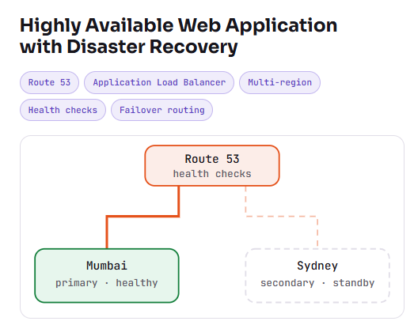

# Highly Available Web Application with Disaster Recovery on AWS

## Overview

This project documents a multi-region web application architecture configured through the AWS Management Console. The application is hosted on Amazon EC2 in two AWS regions:

- **Primary region:** Mumbai, India (`ap-south-1`)
- **Secondary region:** Sydney, Australia (`ap-southeast-2`)

Amazon Route 53 failover routing and health checks were configured using the same application DNS name. The failover setup was tested.

> **Recovery time:** The original design target was under 15 minutes. This is a target, not a measured result, unless you add recorded test evidence below.

## Architecture

## AWS Services

- **Amazon EC2** — hosts the web application in both regions.
- **Application Load Balancer (ALB)** — distributes requests to application targets in each region.
- **Target Groups** — register application targets and report their health.
- **Amazon Route 53** — provides DNS failover routing and health checks.
- **Security Groups** — control network traffic to the load balancers and EC2 instances.

## How It Works

### Normal operation

1. A user accesses the application through its DNS name.
2. Route 53 evaluates the configured failover policy and health checks.
3. Traffic is directed to the healthy primary Mumbai endpoint.
4. The Mumbai ALB forwards requests to healthy application targets.

### Disaster recovery

1. The primary endpoint becomes unhealthy or unavailable.
2. Route 53 health checks evaluate the primary endpoint according to the configured settings.
3. Route 53 can return the secondary Sydney endpoint for eligible DNS queries.
4. The Sydney ALB forwards requests to healthy application targets.
5. Application availability is checked during failover testing.

DNS caching and health-check timing can affect recovery time. Existing connections are not automatically transferred to the secondary region.

## Implemented

- Deployed the EC2-hosted web application in Mumbai and Sydney.
- Configured a separate ALB and target group in each region.
- Configured Route 53 failover records using the same application DNS name.
- Configured health checks for failover decision-making.
- Tested the disaster recovery failover workflow.
- Investigated ALB target health, security group connectivity, DNS routing, and HTTP/HTTPS availability.

## Test Evidence

See [`docs/failover-testing.md`](docs/failover-testing.md) and add actual observations and screenshots when available. Do not claim a specific recovery time unless it was measured.

## Troubleshooting

See [`docs/troubleshooting.md`](docs/troubleshooting.md) to record the symptoms, root causes, fixes, and validation results from your implementation.

## Future Improvements

These are planned enhancements, not part of the current console-based implementation:

- Re-create the infrastructure using modular Terraform.
- Configure an S3 remote backend and appropriate state locking.
- Automate provisioning and deployment through CI/CD.
- Add CloudWatch alarms and dashboards.
- Automate failover tests and record actual RTO.
- Document regional restoration and recovery procedures.

## Skills Demonstrated

AWS EC2, Amazon Route 53, Application Load Balancer, Target Groups, Multi-Region Architecture, High Availability, Disaster Recovery, Health Checks, DNS Failover, Security Groups, and Troubleshooting.

## Implementation Notes

This repository documents an AWS Management Console implementation. Terraform and CI/CD automation are future improvements unless implemented and committed separately.
