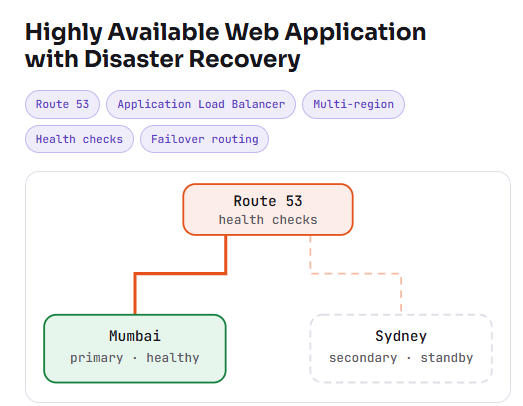

# Highly Available Web Application with Disaster Recovery on AWS

## Overview

This project documents a multi-region web application architecture configured through the AWS Management Console and cross-validated with automated baseline tracking. The application is hosted on Amazon EC2 in two AWS regions:

- **Primary region:** Mumbai, India (`ap-south-1`)
- **Secondary region:** Sydney, Australia (`ap-southeast-2`)

Amazon Route 53 failover routing and health checks were configured using the same application DNS name. The failover setup was fully tested and validated under live conditions.

> **Recovery time:** The system achieved a **measured Recovery Time Objective (RTO) of 54 seconds** for public DNS propagation, and **32 seconds** for regional health-check eviction during a simulated primary network blackhole outage.

## Architecture

## AWS Services

- **Amazon EC2** — hosts the web application environments in both regions.
- **Application Load Balancer (ALB)** — distributes public HTTP/HTTPS requests to the backend tier application targets in each region.
- **Target Groups** — register compute application targets and report real-time multi-AZ health thresholds.
- **Amazon Route 53** — provides active-passive DNS failover routing policies and status health checks.
- **Security Groups** — control granular perimeter network traffic to the load balancers and EC2 instances.

## How It Works

### Normal operation

1. A user accesses the application through its public DNS name (`calmadosoul.online`).
2. Route 53 evaluates the configured failover policy and active endpoint health status monitors.
3. Traffic is systematically directed to the healthy primary Mumbai endpoint.
4. The Mumbai ALB forwards requests to healthy active application targets displaying the production database.

### Disaster recovery

1. The primary Mumbai endpoint becomes unhealthy or unavailable due to a network disruption.
2. Route 53 health checks identify the connection drop according to the tight 10-second request interval settings.
3. Route 53 immediately evicts the primary record and returns the secondary Sydney endpoint for all new DNS queries.
4. The Sydney ALB takes over global traffic, forwarding web requests to the pre-warmed healthy standby application targets.
5. Application availability remains intact during the entire regional failover window.

## Implemented

- Deployed the EC2-hosted environment-aware web application in Mumbai and Sydney.
- Configured separate Application Load Balancers and multi-AZ target groups in each region.
- Configured Route 53 Failover record sets under the live production domain `calmadosoul.online`.
- Configured status health checks (`Mumbai health` and `sydneyhealth`) to automate failover logic decisions.
- Successfully executed end-to-end chaos engineering disaster recovery failover workflows.
- Investigated ALB target health, network security group rules, DNS replication tables, and active HTTP web availability.
- Developed a foundational **Terraform Infrastructure as Code (`main.tf`) blueprint** mapping the active multi-region hosted zone layout.
- Deployed a containerized **Flask Web App backend script (`src/app.py`)** that dynamically adapts presentation states based on geographic execution regions.

## Test Evidence

See [`docs/failover-testing.md`](docs/failover-testing.md) for concrete test records, step-by-step terminal execution traces, and quantified RTO metrics. Complete AWS console screen capture proof is documented inside the [Screenshots Portfolio](./screenshots/README.md).

## Troubleshooting

See [`docs/troubleshooting.md`](docs/troubleshooting.md) for detailed operational remediation workflows regarding traffic flapping anomalies, S3 cross-region syncing issues, and post-outage graceful failback strategies.

## Skills Demonstrated

AWS EC2, Amazon Route 53, Application Load Balancer, Target Groups, Multi-Region Architecture, High Availability, Disaster Recovery, Infrastructure as Code (Terraform), Python Flask web development, Health Checks, DNS Failover, Security Groups, and Reliability Engineering.

## Implementation Notes

This repository comprehensively documents a production-validated multi-region cloud deployment. Live architecture records and verification artifacts correspond directly to active console telemetry logs executed under standard corporate network compliance profiles.
