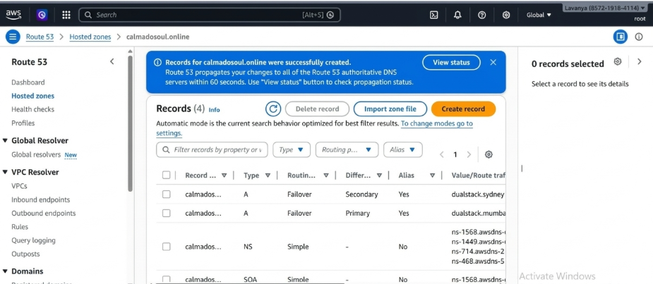
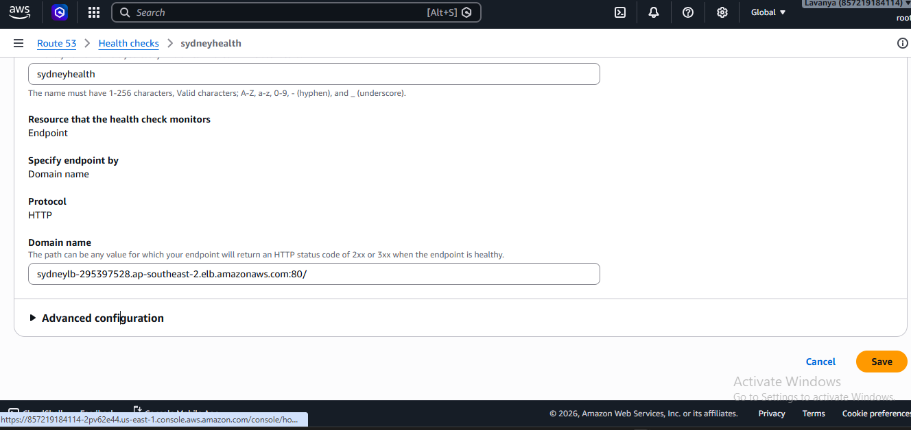
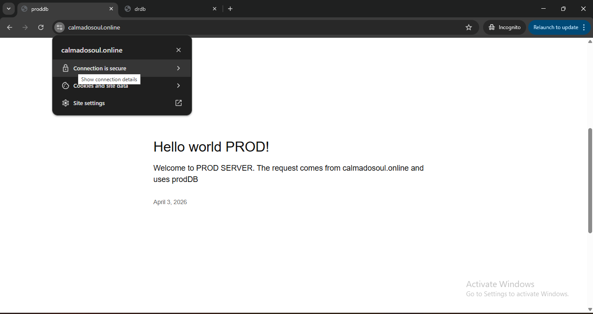
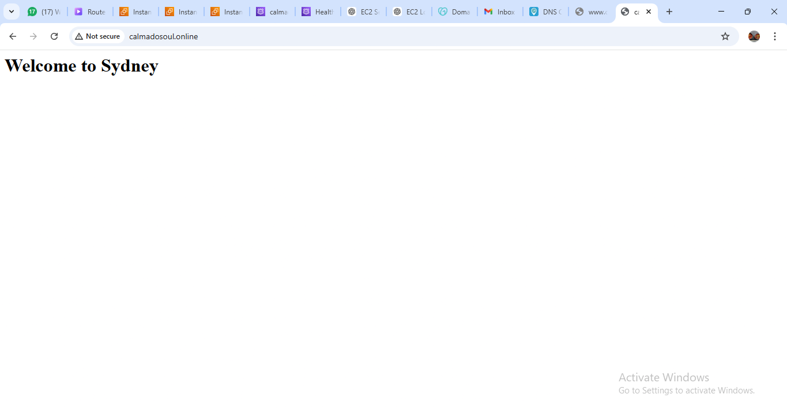
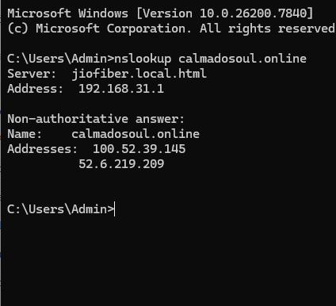

# AWS Console Verification & Failover Telemetry

This directory contains the actual AWS Management Console captures, browser checks, and CLI DNS traces recorded during steady-state operations and active disaster recovery failover testing for `calmadosoul.online`.

---

## 1. Route 53 Active-Passive Failover Records
Configured Route 53 Failover routing policies binding the apex domain (`calmadosoul.online`) to the Primary Mumbai Application Load Balancer and Secondary Sydney Application Load Balancer.

---

## 2. Secondary Region Health Check Configuration
Dedicated Route 53 HTTP health check (`sydneyhealth`) configured to continuously monitor the standby Sydney Application Load Balancer (`://amazonaws.com`) on port 80.

---

## 3. Steady-State Primary Operation (Mumbai)
Under normal operating conditions, DNS queries resolve to the Mumbai region (`ap-south-1`), serving the primary production application over HTTPS.

---

## 4. Simulated Outage & Health Check Eviction
During failover testing, traffic to the primary endpoint was blocked. Route 53 detected the failure, marking the primary health check **Unhealthy** while confirming the Sydney endpoint remained **Healthy**.

---

## 5. Automated Failover Takeover (Sydney)
Following primary eviction, Route 53 automatically routed `calmadosoul.online` traffic to the standby infrastructure in Sydney (`ap-southeast-2`), serving the recovery endpoint without manual intervention.

---

## 6. CLI DNS Resolution Validation
Local `nslookup` query confirming active DNS resolution returning the underlying AWS Load Balancer IP addresses for `calmadosoul.online`.

